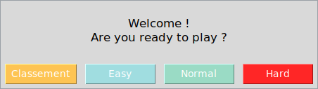
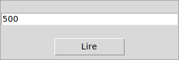
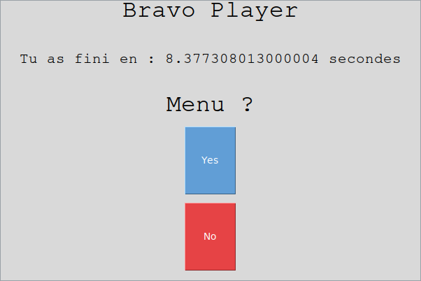
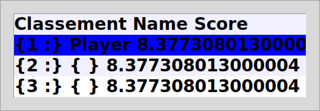

# Guess the Number

[](https://github.com/LaCobble/Guess-the-number/actions/workflows/ci.yml)


[](LICENSE)

A Tkinter "higher or lower" game with three difficulty levels and a scoreboard saved to an Excel file, built under a two-hour time limit.

<p align="center">
  
</p>

## What it does

The game picks a random number and you have to find it: type a guess and press **Lire** (read). The hint, "plus grand" (higher) or "plus petit" (lower), is printed in the terminal the game was started from. The faster you find the number, the better your score.

| Level  | Number to find                         |
|--------|----------------------------------------|
| Easy   | an integer from 1 to 999               |
| Normal | an integer from 1 to 9,999             |
| Hard   | a decimal from 0.01 to 9,999.99        |

When you win, you enter a name and your time is stored in `classement.xlsx`, one sheet per level. The **Classement** (scoreboard) button shows the saved scores for each level.

## Screenshots

Captured on Linux (Xvfb) by running the real program and pressing its buttons; window titles are not shown. The fixed window sizes come from the original code.

<table>
  <tr>
    <td width="50%" align="center"></td>
    <td width="50%" align="center"></td>
  </tr>
  <tr>
    <td align="center"><sub>Main menu: scoreboard and the three levels</sub></td>
    <td align="center"><sub>Game window: type a guess and press <b>Lire</b></sub></td>
  </tr>
  <tr>
    <td align="center"></td>
    <td align="center"></td>
  </tr>
  <tr>
    <td align="center"><sub>Number found: name entered, time displayed</sub></td>
    <td align="center"><sub>Easy scoreboard, read back from <code>classement.xlsx</code></sub></td>
  </tr>
</table>

## Getting started

### Prerequisites

- Python 3.8 or newer with Tkinter. Tkinter ships with the python.org installers for Windows and macOS; on Debian/Ubuntu install it with `sudo apt install python3-tk` (it is **not** installed with `pip`).
- The packages listed in [`requirements.txt`](requirements.txt): `xlrd` 1.x (version 2 dropped `.xlsx` support), `xlsxwriter` and `openpyxl`.

### Install and run

```bash
git clone https://github.com/LaCobble/Guess-the-number.git
cd Guess-the-number
python -m venv .venv
source .venv/bin/activate        # Windows: .venv\Scripts\activate
pip install -r requirements.txt
python "Guess the number.py"
```

The scoreboard file `classement.xlsx` is created in the current folder after the first win; it is ignored by Git.

## Project structure

```text
.
├── Guess the number.py   # the whole game: menu, game window, scoreboard read/write
├── requirements.txt      # Excel libraries used for the scoreboard
└── README.md
```

## What this project demonstrates

- Building a small desktop GUI with Tkinter (windows, buttons, entry fields, pop-ups).
- Persisting data to a spreadsheet with `xlsxwriter` and reading it back with `xlrd`.
- Timing a game with `time.perf_counter`.
- Delivering a complete, playable program under a strict two-hour constraint.

## Context

A personal challenge from 2021: build a complete game with a graphical interface in under two hours. The code is kept as it was written, as a portfolio piece; only the repository around it (documentation, dependency list, CI) has been tidied up.

## Contributing

Issues and small pull requests are welcome: see [CONTRIBUTING.md](CONTRIBUTING.md) and the [Code of Conduct](CODE_OF_CONDUCT.md).

## License

[MIT](LICENSE) © LaCobble
